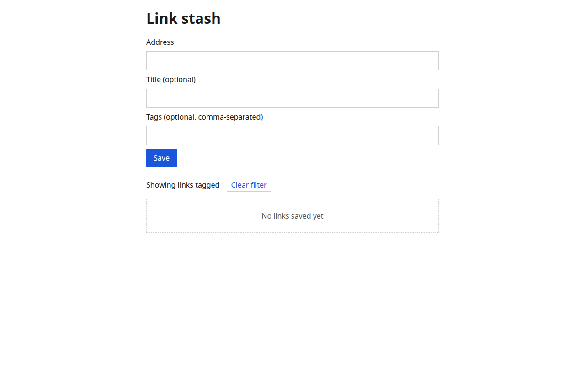
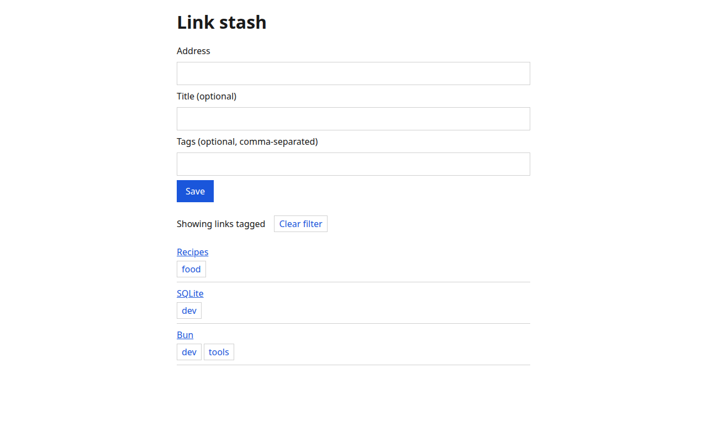

# link-stash

Save links, tag them, search them and share a list read-only.

A sample product built by the forger work loop: owner requests are GitHub issues
labelled `ready-for-agent`, the loop builds each one on its own branch, and a PR
merges only when the gates in `.forger/workloop.config.json` and CI pass.

## What it does

- Save a link from the form on `/`: an address (http or https only) and an optional title. The newest link is listed first, and links persist across restarts.
- `POST /api/links` with `{"url", "title"}` stores a link and answers 201; an invalid address answers 400 with `{"error", "field"}`. `GET /api/links` returns `{"links": [...]}`, newest first.

- Tag a link with a comma-separated field on save; tags are stored trimmed and lower-case and shown on each link. Selecting a tag filters the list, and "Clear filter" shows every link again. `GET /api/links?tag=x` returns only links carrying that tag, and `POST` accepts a `tags` string. Links saved before tags existed have none.




## Develop

```
bun install
bun run check
bun run start
```

`bun run start` serves the page at `/` and the JSON API under `/api/` from one
Bun server, with SQLite (`bun:sqlite`) as the only database.

| Variable | Default | Meaning |
|----------|---------|---------|
| `LINK_STASH_DB` | `link-stash.db` | Path of the SQLite database file |
| `PORT` | `3000` | Port the server listens on |

The schema is created by numbered migrations in `src/storage.ts`. Tests use an
in-memory database and call the request handler directly, so they open no port.
